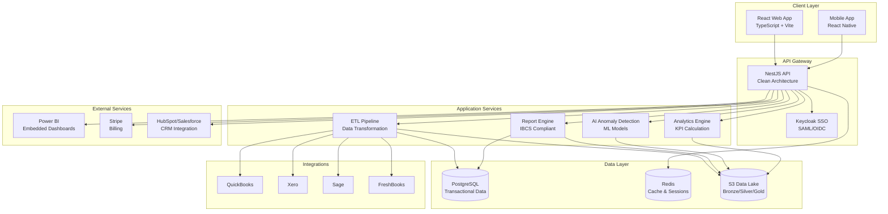

# PlainLedger

<div align="center">

**No surprises. Just numbers.**

[](LICENSE)
[](https://github.com/stonyp90/plainledger)
[](https://github.com/stonyp90/plainledger)
[](https://www.typescriptlang.org/)
[](https://nodejs.org/)

**Enterprise Financial Reporting Platform for Canadian SMBs**

*Connect your accounting software. Generate IBCS-compliant reports. Make better decisions.*

[Documentation](#) • [API Reference](#) • [Pricing](https://plainledger.ca/pricing) • [Schedule Demo](https://calendly.com/anthonypaquet1508)

</div>

---

## 🎯 Value Proposition

PlainLedger is a financial reporting SaaS platform designed for **Canadian small and medium businesses** with **$2M-$20M+ annual revenue**. We transform your accounting data into actionable insights through:

- **🔗 Multi-Provider Integration** - Connect QuickBooks, Xero, Sage, FreshBooks, and more
- **📊 IBCS-Compliant Reports** - Financial statements following ISO 24896 standards
- **🤖 AI-Powered Anomaly Detection** - Catch duplicate payments, fraud patterns, and billing errors automatically
- **📈 Power BI Embedded** - White-label interactive dashboards for stakeholders
- **🏢 Multi-Tenant Architecture** - Support for multiple organizations with per-tenant branding
- **🔐 Enterprise Security** - Keycloak SSO, MFA, audit logs, and Canadian data residency

### Why PlainLedger?

| Traditional BI Tools | PlainLedger |
|---------------------|-------------|
| $50,000+/year | Starting at $500/month |
| 6-12 month implementation | Go live in days |
| Complex setup, IT-heavy | Self-service, CPA-supported |
| Generic dashboards | Industry-specific KPIs |
| US data centers | **Canadian data residency** |

**Average ROI: 340% in first year** • **Average savings: $847K annually**

---

## 🏗️ Architecture



### Technology Stack

- **Frontend**: React 18, TypeScript, Vite, TailwindCSS
- **Backend**: NestJS, TypeScript, Clean Architecture
- **Database**: PostgreSQL 15+, Redis 7+
- **Authentication**: Keycloak 22+ (SSO, MFA, SAML/OIDC)
- **Storage**: AWS S3 / MinIO (S3-compatible)
- **Infrastructure**: Docker, Docker Compose, Terraform, AWS
- **Testing**: Playwright (E2E), Vitest (Unit)

---

## 📊 Feature Comparison

| Feature | Essentiel<br/>($500/mo) | Professionnel<br/>($1,200/mo) | Premium<br/>($2,500/mo) | Enterprise<br/>(Custom) |
|---------|:----------------------:|:----------------------------:|:----------------------:|:----------------------:|
| **Users** | 3 included<br/>(+$50/user) | 5 included<br/>(+$75/user) | 10 included<br/>(+$100/user) | Unlimited |
| **Data Connections** | 3 | 10 | Unlimited | Unlimited |
| **Reports** | Unlimited | Unlimited | Unlimited | Unlimited |
| **AI Anomaly Detection** | ✅ | ✅ | ✅ | ✅ |
| **AI Insights** | ❌ | ✅ | ✅ | ✅ |
| **Power BI Embedded** | ❌ | ✅ | ✅ | ✅ |
| **Power BI White Label** | ❌ | ❌ | ❌ | ✅ |
| **API Access** | ❌ | ✅ | ✅ | ✅ |
| **SSO (SAML/OIDC)** | ❌ | ❌ | ❌ | ✅ |
| **Audit Logs** | ❌ | ❌ | ✅ | ✅ |
| **Custom Branding** | ❌ | ❌ | ✅ | ✅ |
| **Custom Domain** | ❌ | ❌ | ❌ | ✅ |
| **Dedicated CPA Support** | Email | Priority (48h) | Same-day | Dedicated Manager |
| **SLA** | - | - | - | 99.9% |

> **Note**: All plans include a **7-day free trial** (no credit card required). AI features are not available during trial period.

---

## 🚀 Quick Start

### Prerequisites

- **Docker** & Docker Compose (v2.0+)
- **Node.js** 20+ and npm/yarn
- **Git**

### Local Development Setup

#### 1. Clone Repository

```bash
git clone https://github.com/stonyp90/plainledger.git
cd plainledger
```

#### 2. Start Infrastructure Services

```bash
# Start PostgreSQL, Redis, Keycloak, MinIO
chmod +x local-dev/start.sh
./local-dev/start.sh
```

This starts:
- **PostgreSQL** on port `5432`
- **Redis** on port `6379`
- **Keycloak** on port `8080` (Admin: `admin/admin`)
- **MinIO** on port `9000` (Console: `9001`, Credentials: `plainledger/plainledger_secret`)

#### 3. Configure Environment

```bash
# API Configuration
cd apps/api
cp env.example .env.local

# Edit .env.local with your settings
# Default values work for local development

# Web Configuration
cd ../web
cp env.example .env.local
```

#### 4. Install Dependencies & Start

```bash
# Terminal 1 - API Server
cd apps/api
npm install
npm run start:dev
# API runs on http://localhost:3000

# Terminal 2 - Web Application
cd apps/web
npm install
npm run dev
# Web app runs on http://localhost:5173
```

#### 5. Access Application

| Service | URL | Default Credentials |
|---------|-----|---------------------|
| **Web App** | http://localhost:5173 | `demo@plainledger.ca` / `DemoPass123!@#` |
| **API** | http://localhost:3000 | N/A |
| **Keycloak Admin** | http://localhost:8080 | `admin` / `admin` |
| **MinIO Console** | http://localhost:9001 | `plainledger` / `plainledger_secret` |

---

## 🔐 Security & Compliance

### Data Residency

- **Primary**: Canadian data centers (AWS Canada Central)
- **Backup**: AWS Canada West
- **Compliance**: PIPEDA compliant

### Security Features

- ✅ **Encryption at Rest**: AES-256 encryption for all stored data
- ✅ **Encryption in Transit**: TLS 1.3 for all connections
- ✅ **SSO Support**: SAML 2.0, OIDC, LDAP
- ✅ **Multi-Factor Authentication**: TOTP, SMS, Email codes
- ✅ **Audit Logging**: Complete audit trail (Enterprise)
- ✅ **Role-Based Access Control**: Granular permissions
- ✅ **Data Isolation**: Multi-tenant architecture with strict isolation

### Compliance Roadmap

- ✅ **PIPEDA** (Personal Information Protection and Electronic Documents Act)
- ✅ **GDPR** (General Data Protection Regulation) - For EU customers
- ✅ **CCPA** (California Consumer Privacy Act) - For California customers
- 🔄 **ISO 27001** (Information Security Management System) - In progress, expected Q3 2026
- 📋 **ISO 27017** (Cloud Security) - Planned Q4 2026
- 📋 **ISO 27018** (Cloud Privacy) - Planned Q4 2026
- 📋 **CSA STAR Level 2** (Cloud Security Alliance) - Planned Q1 2027
- 📋 **PCI DSS Level 1** (Payment Card Industry Data Security Standard) - Planned Q2 2027
- 📋 **NIST Cybersecurity Framework** - Planned Q2 2027
- 📋 **CIS Controls** (Center for Internet Security) - Planned Q3 2027
- 📋 **SOC 1 Type II** (Service Organization Control) - Planned Q4 2027
- 📋 **SOC 2 Type II** (Security, Availability, Processing Integrity) - Planned Q1 2028
- 📋 **HIPAA** (Health Insurance Portability and Accountability Act) - Planned Q2 2028
- 📋 **FedRAMP** (Federal Risk and Authorization Management Program) - Planned Q3 2028

---

## 📚 API Documentation

### Authentication

All API requests require authentication via Keycloak JWT tokens:

```bash
curl -H "Authorization: Bearer YOUR_JWT_TOKEN" \
     https://api.plainledger.ca/api/datasources
```

### Core Endpoints

#### Data Sources

| Method | Endpoint | Description |
|--------|----------|-------------|
| `GET` | `/api/datasources` | List all connections |
| `GET` | `/api/datasources/:id` | Get connection details |
| `POST` | `/api/datasources` | Create new connection |
| `POST` | `/api/datasources/:id/sync` | Trigger data sync |
| `DELETE` | `/api/datasources/:id` | Remove connection |
| `GET` | `/api/datasources/providers/available` | List available providers |

#### Reports

| Method | Endpoint | Description |
|--------|----------|-------------|
| `GET` | `/api/reports/balance-sheet` | Generate balance sheet |
| `GET` | `/api/reports/income-statement` | Generate income statement |
| `GET` | `/api/reports/cash-flow` | Generate cash flow statement |
| `GET` | `/api/reports/custom` | Generate custom report |

#### Anomaly Detection

| Method | Endpoint | Description |
|--------|----------|-------------|
| `GET` | `/api/anomalies` | List detected anomalies |
| `POST` | `/api/anomalies/:id/resolve` | Mark anomaly as resolved |
| `GET` | `/api/anomalies/stats` | Get anomaly statistics |

> **Full API Documentation**: [api.plainledger.ca/docs](https://api.plainledger.ca/docs) (Swagger/OpenAPI)

---

## 🔌 Supported Integrations

### Accounting Software

- ✅ **QuickBooks Online** (OAuth 2.0)
- ✅ **Xero** (OAuth 2.0)
- ✅ **Sage** (API Key)
- ✅ **FreshBooks** (OAuth 2.0)
- ✅ **CSV Import** (Manual upload)
- 🔜 **Wave** (Coming Q2 2026)

### Analytics & BI

- ✅ **Power BI Embedded** (Azure AD)
- 🔜 **Tableau** (Planned Q3 2026)
- 🔜 **Looker** (Planned Q3 2026)

### CRM & Sales

- ✅ **HubSpot** (API integration)
- ✅ **Salesforce** (API integration)

### Payment Processing

- ✅ **Stripe** (Subscription billing)

---

## 🧪 Testing

### Run Tests

```bash
# Unit tests (API)
cd apps/api
npm test

# Unit tests (Web)
cd apps/web
npm test

# E2E tests (Playwright)
npm run test:e2e

# E2E tests with UI
npm run test:e2e:ui

# E2E tests in headed browser
npm run test:e2e:headed

# View test report
npm run test:e2e:report
```

### Test Coverage

| Suite | Description | Tests | Coverage |
|-------|-------------|-------|----------|
| Landing Page | Marketing, pricing, features | 7 | 95% |
| Authentication | Login, register, password reset | 9 | 92% |
| Dashboard | Layout, navigation, widgets | 9 | 88% |
| Connections | Provider connection flow | 10 | 90% |
| Reports | Financial report generation | 8 | 85% |
| Settings | Subscription, integrations | 20+ | 87% |

---

## 🚢 Deployment

### Cloud Deployment (AWS)

```bash
# Deploy infrastructure
cd terraform
terraform init
terraform plan
terraform apply

# Deploy applications
docker-compose -f docker-compose.prod.yml up -d
```

### Environment Variables

See `apps/web/env.example` and `apps/api/env.example` for required environment variables.

**Required for Production**:
- `DATABASE_URL` - PostgreSQL connection string
- `REDIS_URL` - Redis connection string
- `KEYCLOAK_URL` - Keycloak server URL
- `KEYCLOAK_CLIENT_SECRET` - Keycloak client secret
- `MINIO_ENDPOINT` - S3-compatible storage endpoint
- `STRIPE_SECRET_KEY` - Stripe API key for billing

### Docker Images

```bash
# Build API image
cd apps/api
docker build -t plainledger-api:latest .

# Build Web image
cd apps/web
docker build -t plainledger-web:latest .
```

---

## 📞 Support & SLA

### Support Tiers

| Plan | Support Level | Response Time | Channels |
|------|--------------|---------------|----------|
| **Essentiel** | Email Support | 48-72 hours | Email |
| **Professionnel** | Priority Support | 24-48 hours | Email, Chat |
| **Premium** | Same-Day Support | < 24 hours | Email, Chat, Phone |
| **Enterprise** | Dedicated Manager | < 4 hours | Email, Chat, Phone, Slack |

### Service Level Agreement (SLA)

- **Enterprise Plan**: 99.9% uptime guarantee
- **Premium Plan**: 99.5% uptime guarantee
- **Professionnel & Essentiel**: Best effort

**Support Email**: support@plainledger.ca  
**Sales**: sales@plainledger.ca  
**Schedule Demo**: [calendly.com/anthonypaquet1508](https://calendly.com/anthonypaquet1508)

---

## 💰 Pricing

### Subscription Plans

| Plan | Price (CAD) | Best For |
|------|-------------|----------|
| **Essentiel** | $500/month | Small businesses ($2M-$5M revenue) |
| **Professionnel** | $1,200/month | Growing businesses ($5M-$10M revenue) |
| **Premium** | $2,500/month | Established businesses ($10M-$20M revenue) |
| **Enterprise** | Custom | Large organizations ($20M+ revenue) |

**All plans include**:
- 7-day free trial (no credit card required)
- Unlimited reports
- AI-powered anomaly detection
- CPA email support
- Canadian data residency

**Yearly billing**: Save 20% with annual commitment

> **Enterprise Pricing**: Contact [sales@plainledger.ca](mailto:sales@plainledger.ca) for custom pricing, volume discounts, and on-premise deployment options.

---

## 📖 Project Structure

```
plainledger/
├── apps/
│   ├── api/                    # NestJS API (Clean Architecture)
│   │   ├── src/
│   │   │   ├── domain/         # Domain entities, value objects
│   │   │   ├── application/    # Use cases, ports
│   │   │   └── infrastructure/ # Controllers, repositories, adapters
│   │   └── Dockerfile
│   │
│   └── web/                    # React + Vite frontend
│       ├── src/
│       │   ├── pages/          # Page components
│       │   ├── components/     # Shared components
│       │   ├── contexts/       # React contexts
│       │   ├── lib/            # Utilities, hooks, services
│       │   └── features/      # Feature modules
│       └── Dockerfile
│
├── keycloak/
│   ├── realms/                 # Keycloak realm configuration
│   └── themes/plainledger/     # Custom Keycloak theme
│
├── terraform/                  # Infrastructure as Code
│   ├── modules/                # Reusable Terraform modules
│   └── environments/           # Environment-specific configs
│
├── local-dev/                  # Local development scripts
│   ├── start.sh               # Start all services
│   ├── stop.sh                # Stop all services
│   └── init-*.sql             # Database initialization scripts
│
├── e2e/                        # End-to-end tests (Playwright)
├── docs/                       # Documentation
└── docker-compose.yml          # Local development stack
```

---

## 🤝 Contributing

PlainLedger is currently a proprietary project. For enterprise partnerships, integrations, or feature requests, please contact:

- **Partnerships**: partnerships@plainledger.ca
- **Feature Requests**: [GitHub Issues](https://github.com/stonyp90/plainledger/issues)
- **Security Issues**: security@plainledger.ca

---

## 📄 License

**Proprietary** - All rights reserved.

Copyright © 2026 PlainLedger. This software and associated documentation files (the "Software") are proprietary and confidential. Unauthorized copying, modification, distribution, or use of this Software, via any medium, is strictly prohibited.

---

## 🔗 Links

- **Website**: [plainledger.ca](https://plainledger.ca)
- **Documentation**: [docs.plainledger.ca](https://docs.plainledger.ca)
- **API Reference**: [api.plainledger.ca/docs](https://api.plainledger.ca/docs)
- **Pricing**: [plainledger.ca/pricing](https://plainledger.ca/pricing)
- **Schedule Demo**: [calendly.com/anthonypaquet1508](https://calendly.com/anthonypaquet1508)
- **Support**: [support@plainledger.ca](mailto:support@plainledger.ca)

---

<div align="center">

**Built with ❤️ in Canada**

[Privacy Policy](#) • [Terms of Service](#) • [Security](#)

</div>
